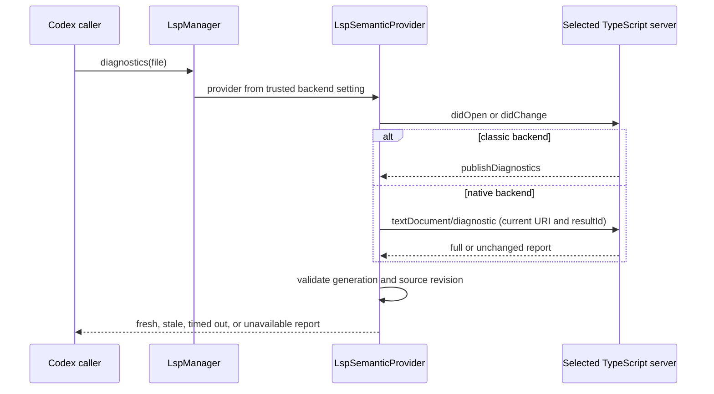

# TypeScript 7 Native LSP - Plan

## Goal Capsule

**Objective:** Add a trusted, opt-in TypeScript 7 native LSP backend that supports the bridge's existing read-only diagnostics and semantic operations.

**Authority:** Follow the Product Contract and Key Decisions below. Keep the existing classic TypeScript Language Server as the default. Do not auto-switch or silently fall back between backends.

**Execution profile:** Implement and verify in the isolated `codex/typescript7-lsp` worktree. Preserve the worktree for user review. Do not commit, push, open a PR, or change global Codex configuration.

**Stop condition:** The opt-in native backend works with a real TypeScript 7 Windows executable, the classic path still works, the integrated comparison records equivalent diagnostic outcomes and timings, and the repo verification gate passes. Leave any decision to change the default for separate review.

---

## Product Contract

### Summary

Add an explicit TypeScript backend setting. When trusted configuration selects `native`, the bridge launches TypeScript 7's native LSP executable directly and uses its standard pull-diagnostic and semantic request contracts. The default stays on `typescript-language-server`.

### Problem Frame

TypeScript 7 provides a native LSP server. The bridge currently starts `typescript-language-server` and sends TypeScript-specific `workspace/executeCommand` requests. The native server uses pull diagnostics and does not support those legacy commands. Running it through the existing path can time out, return no diagnostics, or fail navigation despite the native server being able to serve standard LSP requests.

### Key Decisions

- **Native support is explicit opt-in; classic remains the default.** (session-settled: user-directed — chosen over switching the default now: integrated real-repository correctness and performance evidence is not yet available.) Governs R1, R2.

### Requirements

#### Backend selection and safety

- R1. A user can select the native TypeScript backend only through trusted global language-server configuration.
- R2. Omitting the backend setting preserves classic TypeScript behavior; a selected native backend never silently falls back to classic.
- R3. Native startup requires an absolute direct `executablePath` supplied by trusted global TypeScript configuration. The bridge never discovers and executes a workspace binary based only on a backend toggle. Missing or unsupported executables fail visibly.

#### Diagnostics and semantic behavior

- R4. Native per-file diagnostics use `textDocument/diagnostic` and return only results associated with the current document revision and server generation.
- R5. Native diagnostic timeouts cancel the pending LSP request and remain distinguishable from clean or unavailable diagnostics.
- R6. Native TypeScript/JavaScript requests support the bridge's current definition, references, symbols, and hover operations while keeping all returned locations inside the configured workspace root.
- R7. Directory diagnostics stay within existing file, concurrency, timeout, and workspace-root budgets; the native backend does not request unsupported workspace-wide diagnostics.
- R8. The bridge remains read-only and preserves the existing response contract for status, staleness, source revision, and configuration issues.

#### Evidence and documentation

- R9. A repeatable integrated comparison records cold and warm diagnostics latency and diagnostic outcomes for classic and native servers on the same selected workspace files.
- R10. User documentation explains installation, trusted backend selection, the required absolute executable path, known native limitations, and the fact that classic remains the default.

### Acceptance Examples

- AE1. With no backend setting, a TypeScript file starts `typescript-language-server` with the existing arguments and existing push-diagnostics behavior.
- AE2. With trusted global configuration set to `backend: "native"` and an absolute `executablePath`, the bridge starts exactly that TypeScript 7 executable with native LSP arguments. A valid project returns diagnostics with `status: "ok"`, `stale: false`, and the matching source revision.
- AE3. If workspace-controlled configuration asks for a native executable or backend, the existing trust boundary ignores that executable setting.
- AE4. If the native executable is missing, its startup fails, or it does not provide pull diagnostics, the bridge reports a visible configuration or unavailable error. It does not report an empty clean result and does not start the classic server instead.
- AE5. If a source edit races with a native diagnostics response, the older response is discarded. The report is fresh for the newer revision or remains visibly stale/timed out.
- AE6. A native source-definition request returns a root-checked location; references, symbols, and hover continue to use standard LSP requests.

### Scope Boundaries

- Defer any default change to a separate review after U4 provides integrated evidence (R2).
- Do not add LSP rename, code-action, apply-edit, or other write-capable behavior.
- Do not add automatic backend detection, automatic package installation, or broad workspace scans.
- Native TypeScript does not accept the current TypeScript Server Protocol inferred-project options request. Projects that need those inferred options, including bridge-inferred Node declarations for standalone `.mjs` files, must use explicit `tsconfig.json`/`jsconfig.json` settings or remain on classic.
- The native server reports `workspaceDiagnostics: false`; keep workspace/directory behavior on the existing bounded per-file path.

### System-Wide Impact

This touches trusted configuration parsing, command resolution, process lifecycle, diagnostic freshness, TypeScript-specific navigation, integration coverage, and the main README. The provider must maintain the existing root and generation checks across both push and pull diagnostics. A native server request must not weaken `applyEdit` refusal or process ownership and disposal.

### Risks & Dependencies

- TypeScript 7 packages its platform executable separately. The native backend must launch that executable directly on Windows and other supported hosts. An npm `.cmd` shim is not the native process contract.
- The TypeScript 7.0.2 repository README still labels LSP support as in progress. Exercise the exact bridge operations before users select native.
- Native diagnostics use pull requests. A delayed response must be cancellable and must not overwrite results from a newer source revision or server generation.
- Native TypeScript does not implement the bridge's legacy inferred-project options command. Surface the limitation instead of swallowing it or claiming equivalent inferred-project behavior.
- TypeScript 7's editor ecosystem still has limitations for language-service plugins and embedded-language workflows. Keep native use opt-in and document the supported plain TypeScript/JavaScript path.
- Existing Windows fixture measurements favor native latency but are not an integrated real-repository comparison. They do not justify changing the default.

### Sources

- [Announcing TypeScript 7.0](https://devblogs.microsoft.com/typescript/announcing-typescript-7-0/) describes the native compiler and LSP-based editor support.
- [Progress on TypeScript 7, December 2025](https://devblogs.microsoft.com/typescript/progress-on-typescript-7-december-2025/) describes the LSP transition and feature-compatibility caveats.
- [LSP 3.17 specification](https://microsoft.github.io/language-server-protocol/specifications/lsp/3.17/specification) defines full/unchanged pull reports, result IDs, and request cancellation.
- [TypeScript 7.0.2 repository README](https://github.com/microsoft/TypeScript/blob/v7.0.2/tsc/README.md) records the native LSP feature state and compatibility notes.
- `src/adapters/language-config.ts` owns the current TypeScript command and Windows resolution behavior.
- `src/core/lsp-manager.ts` and `src/core/lsp-semantic-provider.ts` own provider construction, TypeScript-specific commands, and diagnostics lifecycle.
- The Windows TypeScript 7.0.2 evaluation supplied with this task confirms direct native executable launch, pull diagnostics, `workspaceDiagnostics: false`, and rejection of legacy inferred-project options and source-definition commands. Its latency comparison used fixtures and raw JSON-RPC rather than the integrated provider.

---

## Planning Contract

### Key Technical Decisions

- KTD1. Keep backend selection separate from language detection. Add a `classic`/`native` backend field to the trusted TypeScript language-server override. Native mode also requires an absolute `executablePath` in trusted global config. This makes selection an explicit owner decision about both backend and binary; do not discover a workspace executable from the toggle alone. Reject `.cmd`/`.bat` and ambiguous `command` native overrides. (Governs R1, R2, R3.)
- KTD2. Use `textDocument/diagnostic` for native per-file diagnostics. Preserve push diagnostics for classic servers, which keeps their existing reporting path unchanged. Associate pull responses with the captured source revision and client generation. Send the cached report's `resultId` as `previousResultId`; reuse its items only when that request token matches the same-generation cache and the response is `unchanged`. Store the response's `resultId` as the token for the next request, which may differ from the token sent. (Governs R4, R5, R7, R8.)
- KTD3. Give native TypeScript source-definition its native `custom/textDocument/sourceDefinition` request. It replaces the classic TypeScript-specific command while preserving the current semantic API. Do not send native requests through `workspace/executeCommand` for inferred project options. Keep standard definition, references, symbols, and hover behavior. (Governs R6, R8.)
- KTD4. Add a development-only integrated benchmark that runs the existing provider against the same selected files with classic and native backends. The current fixture benchmark is not integrated, so the new harness must check correctness before its timings inform any future default decision. Record latency and diagnostic signatures without setting a pass/fail performance threshold. (Governs R9.)

### High-Level Technical Design

For native requests, a diagnostics deadline sends `$/cancelRequest`. A response that arrives after a later edit or server restart cannot replace the current diagnostics snapshot.

### Assumptions

- Native TypeScript is installed by the user as TypeScript 7, and trusted global config points to the matching platform package's direct executable path.
- The bridge's existing standard LSP support covers the required references, symbols, and hover requests. Native source-definition is the only additional native navigation method required by the existing provider contract.
- The selected TypeScript 7 executable supports `--lsp --stdio`, as verified with the 7.0.2 Windows package.

### Deferred Implementation Notes

- Run the integrated benchmark on the clean feature worktree with TypeScript 7.0.2 and the pinned classic language server. Use representative project files already in that worktree; do not edit the user's current checkout or write source changes for measurement.
- Record tool versions, file paths, cold/warm timings, diagnostic status and signatures, and process cleanup for both backends. The results inform a separate default decision and are not a release threshold.

---

## Implementation Units

### U1. Add trusted native backend selection and explicit executable configuration

**Goal:** Let a user opt into TypeScript 7 without changing classic defaults or executing backend choices from workspace-controlled config.

**Requirements:** R1, R2, R3, R10.

**Dependencies:** None.

**Files:** `src/adapters/language-config.ts`, `src/core/config.ts`, `src/core/lsp-manager.ts`, `src/core/doctor.ts`, `tests/adapters-and-uri.test.ts`, `tests/config.test.ts`, `tests/lsp-manager.test.ts`, `tests/doctor.test.ts`, `README.md`.

**Approach:**

1. Extend the trusted TypeScript override with an optional backend value and validate it as `classic` or `native`. Add `executablePath` for native mode and require an absolute path.
2. Preserve classic defaults and existing workspace-config filtering.
3. Use exactly the explicitly configured native executable path and use native LSP arguments by default. Reject `.cmd` and `.bat` shims, and do not treat `command` or workspace package presence as a substitute for `executablePath`.
4. Fail with an actionable error when the native executable is missing. Do not fall back to classic.
5. Document configuration, platform package installation, executable path discovery, and trust boundary.

**Patterns to follow:** `LanguageServerOverride`, `resolveServerCommand`, `loadConfig`, and `omitWorkspaceExecutableOverrides`.

**Test scenarios:**

- With no backend override, `createLanguageServerConfig` returns the existing classic command and `--stdio` arguments.
- Native selection without an absolute `executablePath` fails with an actionable error. With one, native uses that exact direct executable and native LSP arguments.
- Native `.cmd` and `.bat` executable paths and ambiguous `command` overrides are rejected.
- Invalid backend and path settings produce visible actionable errors. A backend or executable path field on a non-TypeScript language override is invalid.
- Workspace config cannot set `backend`, `executablePath`, `command`, or `args`; trusted global config can.

**Verification:** Existing TypeScript defaults stay unchanged, native configuration requires and launches only the selected absolute executable, and malformed or workspace-provided executable settings fail closed or remain ignored per the current trust contract.

### U2. Support cancellable native pull diagnostics with revision safety

**Goal:** Make native per-file diagnostics fresh, bounded by the caller's deadline, and safe under concurrent edits and server recovery.

**Requirements:** R4, R5, R7, R8.

**Dependencies:** U1.

**Files:** `src/core/json-rpc-lsp-client.ts`, `src/core/lsp-semantic-provider.ts`, `src/core/types.ts`, `tests/json-rpc-lsp-client.test.ts`, `tests/lsp-semantic-provider.test.ts`, `tests/diagnostics-timeout.test.ts`, `tests/diagnostics-batch.test.ts`.

**Approach:**

1. Extend LSP request handling with abort support that sends `$/cancelRequest`, removes the pending request, and ignores late replies.
2. Advertise `textDocument.diagnostic` during native initialization and require the server to advertise `diagnosticProvider`. Request `textDocument/diagnostic` per opened document. Normalize full reports and reuse cached items only when the request's `previousResultId` matches the current-generation cache and the response is `unchanged`; store the response's result id for the next request.
3. Capture generation and document version before each pull. Discard results if either changed while awaiting the server; continue only within the existing deadline.
4. Map cancellation to a timed-out diagnostic report. Treat unsupported methods, malformed reports, or unmatched `unchanged` responses as visible unavailable/errors, never clean diagnostics.
5. Keep directory diagnostics on the existing bounded per-file path and never request workspace diagnostics.

**Patterns to follow:** `requestWithRecovery`, `withDiagnosticsDeadline`, `DocumentRegistry.runSerialized`, `DiagnosticsWaiterController`, `captureDiagnostics`, and current timeout reporting.

**Execution note:** Add characterization coverage for cancellation, source revisions, and server generations before connecting native pull results to the report cache.

**Test scenarios:**

- A native full report maps diagnostic severity, code, message, and range to the existing public shape for the requested file.
- An unchanged report reuses cached items only when the request used the same-generation cached result id; its returned result id is used on the next request, even if the token changed.
- An unchanged response without a current cached result is unavailable, not clean.
- A delayed response past the deadline triggers `$/cancelRequest`, returns timed out, and cannot update the cache when it arrives late.
- A response from an older source revision or generation cannot overwrite a newer report after a concurrent edit or server restart.
- Unsupported pull diagnostics and malformed responses remain visibly unavailable.
- Directory scans continue to honor file, concurrency, time, and root boundaries without calling `workspace/diagnostic`.

**Verification:** Native requests return only revision-current results or a truthful timeout/unavailable report; cancellation, late responses, restart, and concurrent edits cannot produce false-clean diagnostics.

### U3. Adapt TypeScript-specific navigation and inferred-project behavior

**Goal:** Keep the bridge's current semantic operations usable with native TypeScript while avoiding unsupported TypeScript Server Protocol requests.

**Requirements:** R3, R6, R8, R10.

**Dependencies:** U1.

**Files:** `src/core/lsp-manager.ts`, `src/core/lsp-semantic-provider.ts`, `tests/lsp-manager.test.ts`, `tests/lsp-semantic-provider.test.ts`, `tests/typescript-integration.test.ts`, `README.md`.

**Approach:**

1. Carry the selected backend into provider construction.
2. Skip bridge-inferred TypeScript Server Protocol compiler options for native. Surface a configuration issue when these options would otherwise be applied.
3. Use `custom/textDocument/sourceDefinition` for native source-definition and keep the existing classic request unchanged.
4. Continue using standard LSP definition, references, workspace symbols, and hover for the native backend.
5. Validate every returned location through the current workspace-root checks.

**Patterns to follow:** `LspManager.forLanguage`, `LspSemanticProvider.initializeGeneration`, `definitionAt`, `toLocation`, and existing `configurationIssues` reporting.

**Test scenarios:**

- Native initialization does not send `typescript.tsserverRequest` or legacy source-definition commands.
- Native source-definition sends `custom/textDocument/sourceDefinition` and converts a valid result to a root-checked location.
- A source-definition location outside the workspace is rejected.
- Standard definition, references, symbols, and hover continue to work under the native backend.
- Standalone inferred-project behavior surfaces a configuration issue while explicit `tsconfig.json`/`jsconfig.json` remains authoritative.
- Classic initialization and source-definition requests remain unchanged.

**Verification:** All current semantic operations work through native LSP requests, and no unsupported TypeScript Server Protocol command is sent to the native executable.

### U4. Add integrated native acceptance, comparison harness, and user guidance

**Goal:** Prove native and classic behavior through the bridge and make the opt-in usable and reviewable.

**Requirements:** R2, R3, R4, R6, R8, R9, R10.

**Dependencies:** U1, U2, U3.

**Files:** `tests/typescript-native-integration.test.ts`, `scripts/run-native-typescript-integration.mjs`, `scripts/benchmark-typescript-lsp.mjs`, `.github/workflows/ci.yml`, `package.json`, `README.md`.

**Approach:**

1. Add Windows integration coverage using the actual TypeScript 7.0.2 native executable and existing classic server packages. Install TypeScript 7.0.2 under the runner temp directory so the repo lockfile and TypeScript 5 compiler path stay unchanged.
2. Cover fresh diagnostics across open, edit, clean, and restored-error states; verify definition, references, symbols, hover, and clean process disposal.
3. Add a development-only command that accepts a workspace root and representative source files, runs both backends through `LspManager`, and emits JSONL with tool versions, cold/warm latency, diagnostic signatures, status, staleness, and cleanup results.
4. Make the comparison reject differing status or diagnostic signatures, but record timing without enforcing a performance threshold.
5. Document the command and treat its output as evidence for a later default decision.

**Patterns to follow:** `tests/typescript-integration.test.ts`, `scripts/run-integration-tests.mjs`, `package.json` command conventions, and `README.md` configuration examples.

**Execution note:** Validate behavior against both a real classic TypeScript Language Server and the direct native TypeScript 7 Windows executable. Keep the feature opt-in if integrated project evidence is inconclusive.

**Test scenarios:**

- The native integration reports the expected TypeScript diagnostic and then a fresh clean result after the file is corrected.
- Restoring the error produces the expected diagnostic on the latest revision; the provider disposes the native child cleanly.
- Navigation integration returns a valid in-root result for definition, references, symbols, and hover.
- Benchmark output contains comparable cold/warm rows for both backends and the same source files.
- Different diagnostic status/signatures or unclean process disposal fail the comparison; latency variance is recorded without failing correctness.
- Windows CI installs the pinned native executable outside the checkout and runs native integration tests; the repo lockfile and TypeScript 5 compiler path remain unchanged.
- Documentation shows the native opt-in and preserves the classic default instructions.

**Verification:** Repeatable native and classic integration runs produce equivalent expected diagnostics and semantic results. The benchmark records integrated real-workspace measurements and can be rerun with another selected project without editing source files.

---

## Verification Contract

- Run `npm run test:run -- tests/json-rpc-lsp-client.test.ts tests/adapters-and-uri.test.ts tests/config.test.ts tests/lsp-manager.test.ts tests/lsp-semantic-provider.test.ts tests/diagnostics-timeout.test.ts tests/diagnostics-batch.test.ts tests/doctor.test.ts` for the changed units.
- Run `npm run test:integration` for the existing classic TypeScript/Pyright gate and `npm run test:integration:native` with the real TypeScript 7.0.2 native executable on Windows. Windows CI installs TypeScript 7 under runner temp and passes the direct executable path into the native gate.
- Run the integrated comparison on the clean feature worktree and retain its JSONL output outside tracked source files.
- Run `npm run ci:verify` in the feature worktree.
- Review `git diff --check` and the final diff for unrelated changes.

---

## Definition of Done

- Trusted configuration can opt into the direct native TypeScript 7 executable. Classic remains the default and does not change behavior.
- Native pull diagnostics honor timeouts, cancellation, source revisions, process generations, and root boundaries. Failures stay visibly distinct from clean diagnostics.
- Native source-definition, standard navigation requests, symbols, and hover work. The provider does not send unsupported legacy commands.
- Directory bounds and read-only server-request handling remain intact.
- Unit tests, real Windows native/classic integration, and `npm run ci:verify` pass.
- The integrated benchmark records comparable diagnostic outcomes and latency without modifying project source files.
- README guidance matches the shipped behavior. Abandoned experimental code is removed.

---

## Appendix

The supplied Windows fixture benchmark reported substantially lower cold and warm latency for the native server. The integrated provider comparison previously timed out because it sent legacy inferred-project commands and waited only for push diagnostics. These results support implementing the opt-in path. They do not answer whether native should replace classic by default.

## Follow-up before changing the default

Preserve the useful results of the classic backend. TypeScript 7 can use its
own protocol and may word equivalent diagnostics differently.

1. **Measure real Codex workflows.** Reuse the comparison script with a small
   fixed set of files in two or three representative repos. Cover configured TS,
   configured JS with `checkJs`, and an unconfigured Node `.mjs` script. Include
   one solution-style project with references to check repeated file opens. Record
   cold start, repeated unchanged checks, and diagnostics after edits separately.
   For edited files, use the existing integration fixture first and extend the
   benchmark only if repeatable timing would change the default decision.
2. **Close only demonstrated gaps.** Start with the standalone Node fixture.
   Verify that native mode resolves valid Node imports, preserves JSDoc errors,
   and respects the project's checking preference. Check that JSDoc hover still
   exposes useful types. Use an upstream-supported
   native mechanism if the probe proves one works without changing user files.
   Keep classic available for unsupported workspaces. Add one multi-file fixture
   to verify that dependency edits reach importer diagnostics and that bounded
   directory requests and package source navigation remain useful. Pull
   diagnostics can satisfy these outcomes without reproducing push notifications.
3. **Decide from the results.** Use a single implementation agent in one
   worktree. Run focused tests for each confirmed gap and reserve full local CI
   for the combined candidate. Keep opt-in until real Windows integration and
   representative workspaces show trustworthy diagnostics, useful navigation,
   clean shutdown, and a meaningful gain on the workloads Codex actually runs.
   Change the default in a separate PR with a documented classic rollback.
